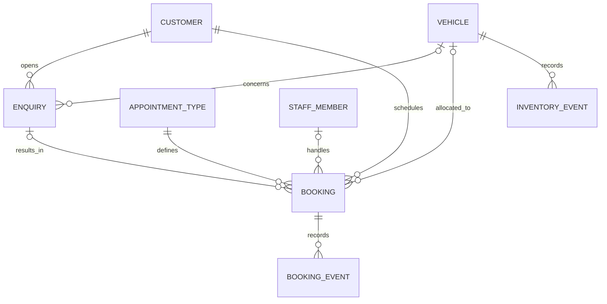

# SHONGWE MOTORS 1.0
## Master Development Blueprint

**Document classification:** Proposed implementation specification for review, not a release certificate  
**Version:** 1.0 draft | **Baseline date:** 29 October 2026  
**Repository:** [Sonkhe-Shongwe/shongwe-motors](https://github.com/Sonkhe-Shongwe/shongwe-motors) | `main`  
**Verified baseline commit at drafting:** `553c1ab6ece80c72394ad7161cccfb91092900ad`  
**Implementation status:** Existing runnable source; modernisation programme not yet implemented  
**Primary platform:** Windows desktop; Python, PyQt5 and SQLite  
**Source of direction:** [Research and Modernisation Report, 29 October 2026](RESEARCH_AND_MODERNISATION_2026-10-29.md)

> **Product contract.** Shongwe Motors must help a small dealership manage customers, vehicle stock and appointments reliably, preserve history, and produce truthful operational information. Attractive screens are not a substitute for correct database rules and demonstrable tests.

---

# 1. Decision authority, baseline and evidence

## 1.1 What this blueprint is and is not

This document defines the recommended 1.0 outcome, functional requirements, data model, architectural boundaries, verification gates, sequence of work and continuing documentation policy. It consolidates the existing audit and research into one implementation guide. The owner has approved undertaking the blueprint exercise, **not** every open business choice or the implementation of any unbuilt feature.

Status vocabulary is mandatory:

| Status | Meaning |
|---|---|
| **EXISTING / OBSERVED** | Source contains the feature or an executed test established the statement. |
| **TESTED** | Evidence identifies a test, environment and observed result; scope is limited to that environment. |
| **REQUIRED FOR 1.0 (RECOMMENDED)** | A proposed release requirement; it is not yet implemented or owner-approved in every detail. |
| **PROPOSED DEFAULT** | A sensible starting policy that must be reviewed before hard-coding business behaviour. |
| **OPEN DECISION** | An unresolved choice which must be decided explicitly before dependent implementation. |
| **DEFERRED** | Outside the proposed first release unless separately authorised. |
| **BLOCKED** | Cannot be claimed complete until its acceptance gate is demonstrated. |

Authority order for development: (1) actual verified source and test results for current implementation; (2) explicitly recorded owner decisions; (3) this blueprint for proposed release contracts; (4) research report for supporting rationale; (5) earlier roadmap/audit for historical status. When a requirement changes, record the decision and revise affected acceptance tests rather than silently changing scope.

## 1.2 Verified starting state (29 October 2026)

The GitHub repository contains `main.py`, `auth.py`, `database.py`, four `.ui` files, logo, requirements, Windows setup/launch scripts, tests and documentation. `main.py` owns the Qt window/controller flow; `database.py` owns SQLite schema, code allocation and CRUD; `auth.py` stores a first-run administrator password hash outside the checkout. `docs/schema_mysql_reference.sql` is a historic alternative schema, **not** an active MySQL integration.

**Observed features:** login and first-run admin setup; customer creation/list/deletion; vehicle creation/list/deletion; booking creation/list/deletion with date/time/calendar and consultant text; SQLite database initialisation; GUI navigation.

**Observed test baseline:** 22 automated tests passed; seven strict expected failures (`xfail`) document missing safeguards. GitHub Actions on the referenced source was successful for Python 3.11/3.12. These results do not prove Windows GUI functionality. Confirm the latest commit and CI before making changes.

**Known unresolved defects:** conflicting appointments accepted; deleting customers/vehicles cascades through booking history; code allocation can reuse an issued display code; negative price/mileage and invalid booking times can be stored; sold vehicles can be booked through the database API. Original source behaviour is recorded in [the audit](AUDIT_2026-10-29.md), and limitations in [test evidence](TESTING.md).

**Current architectural constraints:** SQLite file is beside `database.py`; foreign keys are enabled per connection; several functions use `with connect()` but do not explicitly close connections; booking date/time fields are text with no end interval or lifecycle status; relationships use public `*_code` strings; there is no versioned migration runner. All changes must account for legacy rows.

## 1.3 Non-negotiable engineering principles

- Preserve old working functionality through a baseline parity checklist. No speculative full rewrite.
- Protect existing records before applying migrations; never run destructive development probes on personal customer data.
- Validate every consequential write in application services and appropriate database constraints, not only in a GUI form.
- Booking availability and INSERT must run as one serialised transaction.
- Never delete booking history merely because a linked record is archived or removed from normal lists.
- Claims of security, feature completion, portability or performance require reproducible evidence.
- Demo data, screenshots and commits must not expose real South African ID numbers, contact details, account records or secrets.
- Document every substantial change in GitHub and keep the handoff current.

---

# 2. Product identity, users and boundaries

## 2.1 Product thesis

**Shongwe Motors Dealership Management System**: a local-first Windows application for small dealerships to track vehicle inventory, customer enquiries, test-drive appointments, appointment outcomes and basic sales opportunities, with reliable data retention and operational reporting.

The portfolio differentiator is the **end-to-end business rule**: a customer expresses interest in a vehicle, the dealership schedules an available appointment, the appointment occurs or is cancelled, staff record the outcome and follow-up, and management views metrics backed by the database.

## 2.2 Primary users and deployment assumption

| User | Expected outcome | 1.0 boundary |
|---|---|---|
| Dealership administrator / owner | Maintain stock, customers and appointments, see truthful KPIs, export limited reports | One Windows user profile / local database unless deployment scope changes |
| Sales consultant | Find customer/vehicle, arrange viewing or test drive, record outcome and follow-up | Staff attribution is a proposed feature; dedicated staff logins are not yet approved |
| Portfolio reviewer | Follow setup, run synthetic journey, reproduce unit/integration tests and inspect architecture | No production customer data or live dealership systems required |

**Recommended first-release deployment:** single-machine, offline-first Windows desktop. Do not advertise a multi-user hosted web system, distributed concurrency or remote reservations. Concurrent SQLite connections are still tested because they protect against duplicate form actions and future execution paths.

## 2.3 Scope decisions

| In the recommended 1.0 target | Deferred beyond 1.0 |
|---|---|
| Inventory and customer CRUD with edit/archive | Finance applications, credit scoring and loan origination |
| Customer enquiries and basic opportunity tracking | Online card payments and deposit processing |
| Appointments, durations, availability, cancellation, rescheduling and history | Workshop repair orders, spare parts and procurement ERP |
| Stable relational SQLite schema, safe migrations, backups and recovery | Multi-branch cloud sync and live public online booking |
| First-run local administrator, validated login and safe local storage | OAuth, enterprise directory integration and cloud account management |
| SQL-driven metrics, search/filter and limited safe CSV export | AI chat, lead scoring and predictive analytics without data readiness |
| Automated tests, manual GUI proof, reproducible Windows distribution and docs | Full commercial DMS feature parity |

Additional staff roles are optional unless a genuine multi-user requirement is established. **Do not confuse inventory `Reserved` with a test-drive slot reservation or a customer deposit.** These are distinct business concepts.

---

# 3. Business requirements and workflows

## 3.1 Golden user journey (proposed v1)

1. Administrator launches the app, signs in and sees genuine system status and upcoming work.
2. Administrator adds a vehicle and a customer; existing duplicate identifiers are rejected without partial writes.
3. A customer enquiry records the desired vehicle and follow-up responsibility.
4. Administrator chooses appointment type, resource(s), date and time, then sees availability validated at commit.
5. Confirmed appointment appears in the booking list/calendar with a stable reference code.
6. Staff cancel or reschedule safely, or record attendance/completion and the outcome.
7. Opportunity advances to a documented stage (follow-up, closed won or lost) with truthful vehicle status treatment.
8. Dashboard summarises persisted inventory, eligible appointments and follow-ups, with date filters and definitions.
9. Administrator closes and reopens the application: records, events, reference codes and dashboard figures remain consistent.
10. A reviewer can reproduce the journey with synthetic fixture data and test evidence.

**Baseline parity obligations:** the old four-screen navigation, customer/vehicle/booking creation, field availability, calendar use, listing, refresh, clear and exit must remain usable or be explicitly replaced with a verified equivalent. Existing delete buttons may become *Archive* or *Cancel* after safety migration, with clear UX explaining the change.

## 3.2 Inventory and customer rules

| Requirement | Behaviour | Release check |
|---|---|---|
| INV-01 | A VIN is unique; import or entry follows a declared VIN validation policy | Same VIN rejected in UI and repository tests |
| INV-02 | Prices and mileage cannot be negative; prices use a deliberate fixed-precision representation | Invalid direct SQL/service values rejected |
| INV-03 | Stock status changes use a validated lifecycle; archived or sold units are excluded from incompatible new appointments | Status-eligibility matrix tests |
| INV-04 | Visible customer/vehicle codes remain unique and never reissued after archival or migration | Delete/archive/create cycle tests |
| CUS-01 | Name and required contact fields are checked; duplicate identity treatment is documented; sensitive fields are minimised | Invalid and duplicate fixtures, not real IDs |
| CUS-02 | Archive hides records from active selectors while preserving historical references | History queries continue to resolve |
| CUS-03 | Editing customer/vehicle details never silently rewrites past booking snapshots or audit events | Event/association preservation tests |

An actual sale must be represented by a reviewed outcome or stock event. A stock item's `Sold` status by itself is not evidence that a particular enquiry converted into a sale.

## 3.3 Appointment lifecycle contract (PROPOSED DEFAULT)

Recommended states: `draft` (not yet committed; UI only), `confirmed`, `checked_in`, `completed`, `cancelled`, `no_show`. Persisted bookings begin at `confirmed` unless an explicit request/approval workflow is later approved. Terminal statuses preserve history; reschedule is an auditable update or replacement event.

Suggested transition matrix:

| From | Permitted next state(s) | Extra condition |
|---|---|---|
| Confirmed | Checked in, Cancelled, No show, Rescheduled | Cancel/rebook releases old slot atomically |
| Checked in | Completed, Cancelled (exception) | Require reason for late cancellation |
| Completed | None (except reviewed correction event) | Preserve immutable outcome evidence |
| Cancelled | None; create new booking to rebook | Must not occupy time slots |
| No show | None; create follow-up or new booking | Preserve no-show for truthful reporting |

**OPEN DECISION BR-01:** whether staff must check in, how late a no-show is assigned, and whether post-completion corrections require admin override. Tests and schemas cannot be final until this is resolved.

---

# 4. Booking engine: normative technical design target

## 4.1 Required appointment data

Booking identity: immutable primary key + immutable human-readable reference. Context: customer ID, appointment type ID, optional vehicle ID depending on appointment type, optional consultant/staff ID, location (only if needed), notes, created/updated timestamps. Schedule: start instant, end instant, configured service duration and effective buffer. Lifecycle: status, cancellation or reschedule reason, original booking reference where applicable. Event ledger: who changed what, when and why.

**PROPOSED DEFAULT service policies, not approved business facts:**

| Appointment type | Duration | Exclusive resources | Notes |
|---|---|---|---|
| Test drive | 45 min + 15 min post-buffer | Vehicle; consultant if assigned | Requires eligible, drivable inventory |
| Vehicle viewing | 30 min | Consultant; vehicle only if staff policy requires | Viewing does not automatically reserve sale stock |
| Sales consultation | 45 min | Consultant | May have no specific vehicle |
| Vehicle collection | 30 min | Consultant and identified vehicle | Only after valid handover state |

**OPEN DECISIONS BR-02 through BR-06:** opening hours and holidays; type durations and buffers; whether consultant is mandatory; whether `Reserved` inventory is test-drive eligible; whether the same customer may hold overlapping appointments. Defaults must be visible in settings or clearly declared as static demo policies.

## 4.2 Time semantics and overlapping intervals

Store canonical timestamps (prefer UTC instants plus declared dealership timezone, default proposal `Africa/Johannesburg`); preserve the original input wall-clock and timezone assumption during migration. **Do not silently reinterpret legacy `booking_date` / `booking_time` data.** For local-day display, convert from canonical instants consistently.

Use half-open intervals `[start, end)`. Existing and requested appointments overlap if:

```text
existing.start < requested.end AND existing.end > requested.start
```

A resource may be blocked over the service interval plus a defined effective buffer. Adjacent appointments with no buffer are valid (`end == next_start`). Only states flagged `blocks_availability = true` participate in the conflict calculation (initially confirmed and checked-in).

Validation order: parse and normalise input -> validate booking type/resource policy -> reject impossible/past intervals and outside-business-hours cases -> start database write transaction -> re-read customer/vehicle/staff eligibility -> query overlapping active bookings for each exclusive resource -> reserve unique code/insert booking and event -> commit -> notify UI. The final conflict check is **inside** the transaction; pre-checking in a combo box is never authoritative.

SQLite pattern (conceptual; not a migration script):

```sql
BEGIN IMMEDIATE;
-- Re-check eligibility and time-window conflicts using current committed data.
SELECT id FROM bookings
WHERE vehicle_id = :vehicle_id
  AND status IN ('confirmed', 'checked_in')
  AND start_utc < :requested_block_end
  AND block_end_utc > :requested_start
LIMIT 1;
-- If rows exist: rollback with BOOKING_CONFLICT.
-- Else insert booking + immutable event with generated reference.
COMMIT;
```

SQLite allows one writer at a time; `BEGIN IMMEDIATE` guards the read-check-write sequence against another writer committing a conflicting insert first. Configure a bounded busy timeout and return a clear retryable error on contention. Add indexes to support conflicts; use partial uniqueness for identical active starts only as defence in depth, since SQL uniqueness cannot prove arbitrary interval non-overlap.

If consultant or customer resource conflicts are enabled, check those in the **same transaction**. A partial unique index on active `(vehicle_id, start_utc)` cannot replace this service-level interval policy.

## 4.3 Error and concurrency contracts

| Error | UI behaviour | Durable result |
|---|---|---|
| BOOKING_CONFLICT | Display conflicting slot and offer another time | No booking or event committed |
| RESOURCE_UNAVAILABLE | Identify sold/archived vehicle or unavailable consultant | No booking committed |
| INVALID_INTERVAL | Explain exact invalid field; retain form inputs | No booking committed |
| OUTSIDE_OPERATING_HOURS | State hours/override requirement | No booking committed |
| BOOKING_NOT_FOUND | Refresh record list | No partial mutation |
| DATABASE_BUSY | Explicit retry option; never report success | Transaction rolled back |
| STALE_BOOKING_VERSION | Refresh changed record before editing | Prior booking state preserved |

Double-click submission, app reentry and UI retry need an idempotent operation token or other duplicate guard. Do not claim that a unique code generated in the GUI makes writes idempotent. On reschedule, ensure failure leaves the old booking intact, and success records the old and new slots and change reason in the same transaction.

## 4.4 Mandatory scheduling tests (BK-01 through BK-12)

| Test ID | Scenario | Expected result |
|---|---|---|
| BK-01 | Same car, exact same start, two customers | Only one active booking persists |
| BK-02 | 60-minute appointment at 09:00 then 09:30 | Second booking rejected |
| BK-03 | 09:00-10:00 then 10:00-11:00, no buffer | Both accepted |
| BK-04 | Buffer makes nominally adjacent bookings collide | Second rejected |
| BK-05 | Cancel then reuse former slot | Reuse succeeds; cancellation remains historical |
| BK-06 | Two SQLite connections simultaneously submit same slot | One commits; one returns controlled conflict/busy error |
| BK-07 | Sold/archived/unavailable vehicle | Booking rejected according to type policy |
| BK-08 | Consultant conflict (when applicable) with different vehicles | Second rejected |
| BK-09 | Past time today, impossible date/end-before-start | Invalid data rejected in service and storage |
| BK-10 | Outside operating hours, including end after closing | Rejected or recorded approved override |
| BK-11 | Reschedule into occupied slot | Old booking unchanged; no partial event |
| BK-12 | Double-click/repeated request | Single booking, stable reference and event sequence |

All twelve tests must move from proposed to real assertions in the release branch. Seven historical xfails from the baseline must not simply be deleted to improve test statistics.

---

# 5. Database specification and preservation policy

## 5.1 Current versus target entities

**EXISTING tables:** `customers`, `vehicles`, `bookings`. Human-readable codes are current relationships. `bookings.customer_code` and `bookings.vehicle_code` have `ON DELETE CASCADE`, which has been demonstrated to remove history. Price uses `REAL`; there is no lifecycle status or persisted end time for bookings.

**TARGET entities (not yet created):**

| Entity | Key fields and invariants | Main relationships |
|---|---|---|
| `customers` | `id` immutable PK; `customer_code` UNIQUE; minimal contact; `is_archived`, timestamps | 1:M enquiries and bookings |
| `vehicles` | `id` immutable PK; `vehicle_code` UNIQUE; `vin` UNIQUE; nonnegative `price_cents`, `mileage`; status; archive | 1:M enquiries, bookings and inventory events |
| `appointment_types` | `id`, name UNIQUE, duration/buffer, resource flags, enabled | 1:M bookings |
| `staff_members` (optional 1.0) | `id`, name, active flag, no full RBAC implied | 1:M booked appointments |
| `bookings` | `id`, `booking_code` UNIQUE, FK IDs, type, `start_utc`, `end_utc`, `block_end_utc`, status, timestamps | Customer, vehicle if required, staff if required, events |
| `booking_events` | Immutable `id`, booking FK, event kind, prior/new state, occurred_at, actor label, reason | M:1 booking |
| `enquiries` / `opportunities` | Customer FK, optional vehicle/staff FKs, stage, opened/closed dates, follow-up | 1:M interaction/outcome history if justified |
| `inventory_events` | Vehicle FK, status/price change, actor, time and reason | M:1 vehicle |
| `schema_migrations` or `PRAGMA user_version` | Schema version and audit/checks | One canonical migration history |

Status fields must have a documented enum and allowed transitions. `CHECK` constraints enforce domains that can be represented in SQLite, but business-dependent policy belongs in tested services. Use `ON DELETE RESTRICT` / archival rather than cascade for historical booking relationships; permanent purges require a separate reviewed policy.

## 5.2 Conceptual entity relationship diagram



The diagram is **conceptual only**. It is not evidence these target tables or optional relations have been implemented. The `ENQUIRY` to `BOOKING` link is optional and requires a decision on conversion attribution; staff records are optional in a single-user deployment.

## 5.3 Schema and integrity invariants (DB-01 to DB-10)

- **DB-01:** Foreign keys enabled and verified on every connection (`PRAGMA foreign_keys=ON`).
- **DB-02:** Public codes and VINs unique, immutable and never reused. Generate after allocating a stable DB identity or from an explicit monotonic sequence inside a transaction.
- **DB-03:** Use immutable integer primary keys for relationships in target schema; preserve legacy visible codes and existing references during migration.
- **DB-04:** Reject negative amount or mileage, invalid booking intervals and unknown lifecycle states at the correct boundaries.
- **DB-05:** Store amounts in integer cents or explicitly validated `Decimal` representation; migrate old `REAL` values with documented precision checks, no silent rounding.
- **DB-06:** Archive linked customers/vehicles without destroying booking and inventory/event history.
- **DB-07:** Every booking state change produces a persisted event; cancelled records are queryable.
- **DB-08:** Services use transaction ownership and explicit connection close; retryable `busy` failures are not silently swallowed.
- **DB-09:** Migrations use schema versions, consistent backup, preflight anomaly detection, verification and abort-on-failure.
- **DB-10:** Application-data location is per OS user, not source checkout; old DB relocation is backed up and verified before adopting new path.

## 5.4 Migration protocol (normative)

1. Inspect database version, file location, integrity, FK status, row counts, old public codes, referential gaps, duplicate appointment slots, invalid amounts and time strings.
2. Create a consistent SQLite backup using the backup API and record source/backup checksums; keep the original unchanged during dry run.
3. Apply schema upgrade to a **copy** using versioned migrations; write transformations and anomaly resolutions with deterministic rules. Never auto-delete historical conflicts.
4. Verify record counts, all public codes, relationship cardinality, event backfill, `PRAGMA foreign_key_check`, `PRAGMA integrity_check` and new service contract tests.
5. Test restore from the backup, including failure injection for malformed rows or write interruption.
6. Migrate live data only after approving a mapping report; perform bounded write/commit, update version and reopen application.
7. If old booking times cannot be unambiguously interpreted, quarantine or flag them for review. Do not invent durations or status history for legacy bookings without labelling the assumption.

**Critical migration note:** SQLite transactions do not automatically coordinate arbitrary external file moves and a database commit. For backup/relocation, stage files, validate hashes, perform controlled rename/swap, and recover an interrupted operation on restart.

## 5.5 Backup, restore and retention

Backups belong in user-controlled application data or an explicitly chosen external location, never the GitHub repository or release ZIP. Offer manual backup first. Restore must verify the snapshot, confirm target, avoid silent overwrite and preserve the original file for rollback. Retention and permanent deletion of South African personal information need a separately documented legitimate-purpose policy, distinct from operational booking history and subject to applicable privacy obligations.

---

# 6. Authentication, privacy and threat model

## 6.1 Actual baseline and target

**EXISTING:** `auth.py` performs local single-administrator creation and salted PBKDF2-HMAC-SHA256 password verification; admin record is in `%APPDATA%\ShongweMotors\admin.json` on Windows. This removes the original demonstration plaintext password. GUI checks are not protection from an actor able to modify local app files or SQLite records.

**RECOMMENDED 1.0:** verify first-run setup, login, failed login, logout and protected navigation on Windows; minimum password length and retry policy reviewed; username and password not logged; account record file permissions documented; backups and password reset/recovery designed without deleting customer records. Reject any advertisement of cloud security, multi-tenant RBAC or encrypted database-at-rest without evidence.

## 6.2 Threat/control register

| Threat | Required mitigation | Verification |
|---|---|---|
| Hardcoded credentials / repo secrets | No default login; secret and synthetic-data scan before publication | Repo scan and auth tests |
| Local database exposure | OS-user-specific app-data path; sensible filesystem permissions; documented limitations | Windows path/permission inspection |
| Unauthorised UI navigation | Controller-level session guard; logout clears context | GUI tests bypassing ordinary button flow |
| Password guessing | Bounded attempt handling, generic errors, password policy and recovery | Headless and GUI invalid-login tests |
| Data loss through deletion | Archive/history constraints and backup/recovery tests | Migration tests and event history |
| PII in demos/logs | Synthetic fixture data; redacted logs; minimal collected fields | Release artifact inspection |
| Corrupt upgrade or disk failure | Pre-migration backup, integrity checks and recoverable state | Failure-injection drill |

The product stores South African customer information, potentially including ID numbers. Treat POPIA-informed minimisation, security safeguards and careful deletion as requirements for any real deployment. This document does not certify legal compliance.

---

# 7. Application architecture and interface contracts

## 7.1 Architectural decision ADR-001 (PROPOSED)

**Keep PyQt5 + SQLite for 1.0.** Reuse existing Qt Designer screens, modularise around independently testable application services, and avoid switching to a web or cloud architecture before the core workflows are reliable. PyQt/PySide licensing must be reviewed before final binary distribution; optional Qt6/PySide6 transition is a separate decision after core acceptance.

```text
Qt windows / form controls
          |
          v
Application services (validation, lifecycle, availability)
          |
          v
Repositories + unit-of-work (transaction boundaries)
          |
          v
SQLite (constraints, FKs, migrations and durable events)
```

The GUI can *preview* availability, but only the service in an atomic database transaction can *confirm* a booking. Neither a Qt window nor an SQL helper should silently implement conflicting business policies.

## 7.2 Incremental target modules (not current files)

```text
main.py                      # bootstrap and application controller
app/ui/                      # Qt page adapters, reusable widgets, styling
app/domain/                  # statuses, value objects, appointment policies
app/services/                # bookings, customers, inventory, enquiries
app/persistence/             # connection manager, migrations, repositories
app/reporting/               # verifiable SQL queries and CSV exports
auth.py                      # local account verifier, later auth service
assets/                      # brand assets and icons
tests/unit/                  # domain and validation logic
tests/integration/           # file-backed SQLite, migrations, concurrency
tests/gui/                   # pytest-qt / Windows smoke
 docs/                      # specifications, decisions, test evidence
```

A one-shot directory rewrite is **not required**. Extract one service at a time, retaining adapters for existing `database.py` APIs until parity tests pass. When an adapter is retired, record it explicitly in the changelog.

## 7.3 UI and accessibility requirements

Retain the Shongwe Motors identity. Proposed navigation: Dashboard, Inventory, Customers, Appointments, Opportunities and Settings. Improve existing forms first: in-place error messages, visible resource availability, meaningful appointment detail, search/filter, edit/archive, booking cancel/reschedule, clear disabled/empty/loading states, confirmation dialogs explaining consequences, keyboard focus/tab order, legible table formatting at common Windows screen sizes.

Do not invent dashboard data, display misleading conversion percentages, add decorative animated metrics or silently hide stale/error states. A clean 1366x768 Windows layout and 125% text scaling should be manually reviewed.

## 7.4 Reporting definition register (RP-01 to RP-06)

| Metric | Approved formula needed before display | Source prerequisite |
|---|---|---|
| Active inventory | Count non-archived inventory per defined stock status | Valid vehicle status history |
| Upcoming appointments | Active bookings starting after local reporting instant | Canonical start/status and timezone |
| Attendance rate | Attended eligible test drives / matured scheduled test drives | Reliable outcome statuses and cohort period |
| Overdue follow-ups | Open opportunities with next_action_date before report date | Enquiries and stage definitions |
| Enquiry-to-test-drive | Distinct eligible enquiries with confirmed test drive / matured enquiries | Traceable enquiry-booking relationship |
| Test-drive-to-sale | Matured opportunities with qualifying drive and verified sale / eligible driven opportunities | Opportunity and verified sale outcome |

For every KPI, define grouping grain, period boundary, status inclusion, null policy, denominator and sample fixture expectation. If the supporting records do not exist, **hide the KPI or mark it unavailable**; never synthesize success metrics from stock status alone.

---

# 8. Automated testing, Windows validation and release gates

## 8.1 Testing layers

| Layer | Tools and scope | Expected proof |
|---|---|---|
| Unit | pytest, pure Python | Validation, statuses, interval boundaries, amount conversion |
| SQLite integration | pytest, temporary file DB, separate connections | FK, conflict, codes, archival, atomic reschedule, migration, backup |
| GUI | pytest-qt / real Qt widgets | First-run/login/logout, form errors, navigation, calendar, table refresh |
| Windows acceptance | Supported Python 3.11/3.12 machine and later packaged build | Fresh setup, real launch, persistence, screenshots, recovery |
| Static/security | compileall, Ruff or equivalent, CI and secret hygiene | No syntax issues, tests pass, no user DB/credentials in artifact |

**Current suite:** 22 passing, 7 xfail; this is baseline-only and not sufficient for release. CI green does not certify the GUI. Document test commands, exact OS/Python, fixtures and evidence for each gate.

## 8.2 Formal release gates

| Gate | Required acceptance evidence | Status at blueprint creation |
|---|---|---|
| G0: Legacy parity | Full four-screen Windows walkthrough and known-function inventory | **NOT VERIFIED** |
| G1: Booking integrity | BK-01..BK-12, two-connection and reschedule test | **NOT IMPLEMENTED** |
| G2: Data preservation | Legacy migration dry run, archive retains history, backup/restore tested | **NOT IMPLEMENTED** |
| G3: Security baseline | Windows first-run/login/logout/navigation and local path tests | **PARTIAL HEADLESS EVIDENCE** |
| G4: Business journey | Synthetic enquiry-to-outcome-to-opportunity flow | **NOT IMPLEMENTED** |
| G5: Reporting | Each KPI matches independently computed fixture totals | **NOT IMPLEMENTED** |
| G6: GUI quality | Keyboard focus, 1366x768 and 125% scaling, error paths | **NOT VERIFIED** |
| G7: Distribution | Clean Windows machine runs packaged application with data in app-data path | **NOT IMPLEMENTED** |
| G8: Portfolio evidence | Source, ERD, decisions, screenshots, tests, demo, limitations and licence | **PARTIAL DOCS** |

Release sign-off requires G0-G8 accepted with recorded proof. **Automatic stop:** known critical double-booking or data-loss defects, a failing migration restore, hardcoded secrets, or untested credential/session recovery prevent a 1.0 release label. A missing optional enhancement does not block release if it is explicitly removed from approved scope and docs.

## 8.3 Representative acceptance scenarios

- **AC-01:** Fresh clone, Windows setup, first-run account, login, close and reopen with same data.
- **AC-02:** Create customer/vehicle; duplicate VIN/identifier and negative cost rejected without partial records.
- **AC-03:** Book test drive; conflicting second request blocked even from separate connection.
- **AC-04:** Cancel and reschedule; old schedule and event history preserved, formerly occupied slot freed.
- **AC-05:** Archive a customer or vehicle; linked booking references and timeline remain queryable.
- **AC-06:** Migrate anonymised legacy database and verify old codes, counts, foreign keys and backup restoration.
- **AC-07:** Complete enquiry -> test drive -> opportunity; verify no sale is inferred without sale evidence.
- **AC-08:** Dashboard counts match explicit SQLite fixture SQL; future appointments do not count as attended.
- **AC-09:** Invalid credentials, logout, and direct navigation attempts never expose protected GUI pages.
- **AC-10:** Release artifact contains no populated DB, real IDs, password records, logs or development secrets.
- **AC-11:** App runs at 1366x768/125% scaling; all critical controls reachable by keyboard.
- **AC-12:** Simulated migration/disk failure preserves a restorable original copy and reports recovery clearly.

---

# 9. Delivery roadmap, dependencies and GitHub work tracking

## 9.1 Implementation sequence

| Milestone | Priority | Deliverables | Depends on | Exit criterion |
|---|---|---|---|---|
| **M0 - Freeze & Windows baseline** | P0 | Existing feature parity, synthetic demo fixture, operating-hour/duration decisions | None | G0 signed off; booking policy recorded |
| **M1 - Booking integrity** | P0 | Domain policy, booking service, atomic overlap check, statuses/events, cancel/reschedule | M0 policy | BK-01..BK-12 pass, no conflicting writes |
| **M2 - Data preservation** | P0 | Versioned migrations, stable codes, archive, integer FK IDs, money representation, restore | M0; can design alongside M1 | G2 passed on copied legacy databases |
| **M3 - Auth & local data** | P0 | Windows auth acceptance, safe app-data relocation, recovery and privacy tests | M0, migration protocol | G3 and AC-09 pass |
| **M4 - Business workflow** | P1 | Enquiries, opportunities, outcomes, stock transitions | M1-M2 | G4 synthetic golden journey passes |
| **M5 - Usability & reporting** | P1 | Search/filter, appointment UX, SQL KPI dashboard, limited safe CSV | M1-M4 | G5-G6 and sample results pass |
| **M6 - Portfolio release** | P1 | Test expansion, reviewed docs, screenshots, Windows package, licence decision, clean-install checks | All previous | G0-G8 accepted |
| **M7 - Optional evolution** | P2 | Web/notifications/multi-user only with new case | 1.0 evidence | Separate proposal and gates |

**Scheduling safety versus migration sequencing:** Do not deploy a conflicting hybrid schema. M1 and M2 may be developed on a branch together when the new booking model depends on new foreign keys. The **first production migration and booking-service activation must be one tested, recoverable compatibility checkpoint**. Order here is about learning and safety, not an instruction to run migrations on an unverified DB.

## 9.2 Existing GitHub issues and mapping

| Issue | Existing state at draft | Blueprint work |
|---|---|---|
| [#1 Safe source import](https://github.com/Sonkhe-Shongwe/shongwe-motors/issues/1) | Closed | M0 source baseline prepared; Windows GUI sign-off still outstanding |
| [#2 Conflict prevention](https://github.com/Sonkhe-Shongwe/shongwe-motors/issues/2) | Open | M1, BK-01..BK-12 |
| [#3 History retention](https://github.com/Sonkhe-Shongwe/shongwe-motors/issues/3) | Open | M2, DB-06..DB-09 |
| [#4 Authentication](https://github.com/Sonkhe-Shongwe/shongwe-motors/issues/4) | Open | M3; partial hashed-login work already shipped |
| [#5 DB constraints/migration](https://github.com/Sonkhe-Shongwe/shongwe-motors/issues/5) | Open | M2-M3, DB-01..DB-10 |

After reviewing this blueprint, create issues for M4-M6 or add scoped milestone tasks. Do **not** mislabel unapproved proposed features as completed or close issues based only on documentation.

## 9.3 Development protocol and evidence preservation

1. Read `docs/CONTINUE_HERE.md`, this blueprint, the research report, and open issues; inspect branch head and working code.
2. Record intended scope and test cases before changing the implementation.
3. Start from a clean branch or reviewable PR; protect against commits of .db, account files, sample PII or secrets.
4. Implement the smallest coherent slice and keep compatibility adapters until tests prove behaviour parity.
5. Run automated suites and record expected failures separately from true passes. Do Windows GUI tests when the milestone touches forms.
6. Update `README.md`, `docs/TESTING.md`, this blueprint's decision record/addendum, `docs/ROADMAP.md` and `docs/CONTINUE_HERE.md` after accepted milestone changes.
7. Link evidence to GitHub issues and release notes; never use a test count or CI icon as evidence of untested security or GUI behaviour.
8. If verification fails, mark BLOCKED, preserve the last passing branch and document the exact reproduction and recovery path.

## 9.4 Definition of done for every feature

A feature is done only if its user behaviour is demonstrable, database rules are independently enforced, failure/edge cases have tests, relevant Windows UI is inspected, documentation and issue status reflect implementation, and no known regression was introduced. Mockups, conceptual tables and this specification are not implementation evidence.

---

# 10. Decisions to resolve and change control

The following choices are not silently approved by producing this document:

| ID | Open question | Proposed default / decision owner | Blocks |
|---|---|---|---|
| D-01 | Service types, durations and buffers | Test drive 45+15; viewing 30; consultation 45; collection 30. **Owner review required.** | M1 scheduling tests and schema seed |
| D-02 | Operating hours, holidays and late arrivals | Single local dealership timezone; weekday hours require owner specification | M1 availability/calendar |
| D-03 | Consultant identity and overlap | Optional consultant linked to an appointment; when assigned, cannot double-book | M1 resource semantics; M4 staff |
| D-04 | Inventory `Reserved`, `Sold` and `Archived` meanings | Restrict sold/archived from test drive; reserved subject to policy | M1 and M4 eligibility |
| D-05 | Customer overlapping appointments and cancellation cutoff | Permit only if policy explicitly allows; default propose block exact overlapping active bookings | M1 validation |
| D-06 | Booking status transitions and corrections | Confirmed -> checked-in -> completed, cancel/no-show with event log | M1 booking history |
| D-07 | Contact/ID retention and permanent deletion | Archive operational records; purge under documented privacy policy | M2 privacy/migration |
| D-08 | Enquiry/opportunity relationship and sales evidence | Basic pipeline with explicit close-won result, no inferred sales | M4 and G5 KPIs |
| D-09 | PyQt5 distribution licence and potential PySide6 migration | Review original licensing before public binary release; no framework switch now | M6 distribution |
| D-10 | Installer or zipped runnable distribution | Prefer clean Windows package at final gate, not during data migrations | M6 release |
| D-11 | Admin password minimum and recovery | Keep safe existing first-run flow; review stronger passphrase policy and supported recovery path | M3 security acceptance |
| D-12 | Authentication and staff account scope | One local admin for 1.0; staff attribution not equivalent to separate accounts | M3/M4 roles |

**Default resolution policy:** choices remain proposed until an explicit owner decision is recorded in `docs/decisions/` or a reviewed update to this document. New requirements must specify motivation, changed database entities, migration effect, test impacts, scope trade-off and release-gate changes.

---

# 11. Portfolio positioning and release narrative

The application should demonstrate the ability to design an actual business system rather than a disconnected CRUD exercise. Credible, defensible technical highlights for a future CV/GitHub project section, **once actually implemented and tested**, include transaction-safe appointment scheduling, normalised SQLite modelling, schema migrations with verified backups, customer/vehicle historical retention, secure local admin authentication, automated regression testing and SQL-derived operational reports.

Do not claim these capabilities before evidence exists. The portfolio README should eventually include a brief problem statement, architecture/ERD, screenshots of real synthetic records, installation, sample credentials creation process (not an actual password), test commands, representative conflict test, known constraints, and a short demonstration video or GIF if useful.

Proposed 1.0 release criterion: all gates G0-G8 pass; no known critical booking or data-loss risk remains; screenshots and installer are tested on a clean Windows profile; actual license obligations are reviewed; all sample data is synthetic; data remains intact after close/reopen and failed migrations.

---

# 12. Source and continuity register

## Repository authority

- [Main repository](https://github.com/Sonkhe-Shongwe/shongwe-motors)
- [Research and Modernisation Report](RESEARCH_AND_MODERNISATION_2026-10-29.md): comparative systems, technical references, trade-offs and portfolio justification.
- [Source Code Audit](AUDIT_2026-10-29.md): observed faults, direct database probes and limitations.
- [Test Evidence](TESTING.md): executed test outcomes and Windows acceptance status.
- [Engineering Roadmap](ROADMAP.md): historical milestones and test priorities.
- [Windows Setup](SETUP_WINDOWS.md): actual run instructions and manual acceptance tasks.
- [Continuity Handoff](CONTINUE_HERE.md): current branch, next step, known blockers and decisions.
- [Open GitHub issues](https://github.com/Sonkhe-Shongwe/shongwe-motors/issues): work tracking and acceptance evidence.

## Research and third-party references

The underlying 29 October research report contains the full citation register for comparable dealership and scheduling products and authoritative SQLite, Qt, Python, security, privacy and packaging guidance. This blueprint adopts its conclusions as **recommendations**, not assertions that those systems' features are present in our code. Any subsequent verification of library versions, licensing or legal obligations must use the relevant current authoritative source at implementation time.

## Change log

| Date | Blueprint version | Status | Change |
|---|---|---|---|
| 29 Oct 2026 | 1.0 draft | Prepared for owner review | Consolidated product scope, business rules, proposed entity model, migration contract, booking transaction design, 12 scheduling tests, release gates and issue traceability. No application code changed. |

**NEXT EXECUTION CHECKPOINT:** obtain owner approval of D-01 through D-06 (booking semantics) and complete M0 real-Windows baseline before M1/M2 code edits. If choices remain open, domain-independent tests and migration preflight may be prepared, but no unapproved operating-hours or availability policy should be hard-coded.
